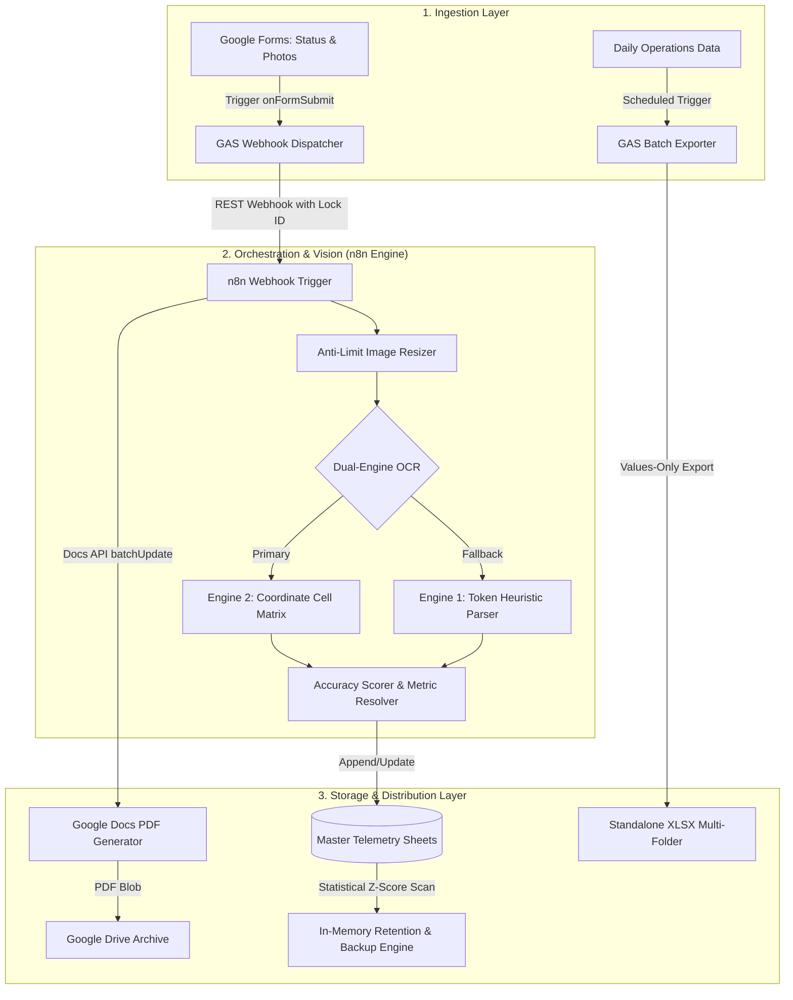

# ⚡ Enterprise Infrastructure Automation & Telemetry Data Pipeline

[](https://n8n.io/)
[](https://workspace.google.com/)
[](https://ocr.space/)
[](LICENSE)
[](https://github.com/pandamanaaja/telemetry-workflow-automation/actions/workflows/ci.yml)

Production-tested, enterprise-grade workflow automation for **industrial transmitter telemetry ingestion**, **field maintenance report generation**, **large-scale anomaly detection**, and **automated data retention pipelines**.

---

## 🏗️ System Architecture



---

## 🌟 Key Components & Engineering Highlights

### 1. 📡 Industrial Telemetry OCR Pipeline (`n8n-workflows/01-industrial-telemetry-ocr.json`)
* **Dual-Engine OCR with Dynamic Fallback**:
  * Utilizes primary coordinate-based relative box mapping (`Static Cell Matrix`) for standardized telemetry display panels.
  * Dynamically evaluates confidence scores and triggers fallback token scanning if the primary score falls below 88% or confidence is low.
* **Domain-Specific Ambiguity Correction**:
  * Context-aware character disambiguation: safely converts `O/Q/D` $\rightarrow$ `0`, `I/l` $\rightarrow$ `1`, `S` $\rightarrow$ `5`, and `B` $\rightarrow$ `8` only inside numeric metric fields while preserving textual unit labels.
  * Hard-locks engineering physical limits (e.g., Driver Power Amplifier `DPA1` clamped to `0.3–1.2A`, `DPA2` to `3.5–5.0A`, and Final Power Amplifier `FPA1–8` to `7.0–10.8A`).
* **Concurrency Guard & Auto-Cleanup**:
  * Batches image downloads in small slices (1–3 images per cycle) with adaptive sleep intervals to strictly adhere to OCR and Drive API rate limits.
  * Permanently purges temporary uploaded raw images from Drive upon successful sheet insertion, saving cloud storage quotas.

### 2. 📑 Dynamic Document & PDF Report Generator (`n8n-workflows/02-site-visit-report-autocrat.json`)
* Replaces legacy Autocrat add-ons with a resilient, native Google Docs API `batchUpdate` engine.
* **Smart Adaptive Image Layout**: Calculates the number of uploaded site documentation photos and dynamically resizes image bounding boxes (`magnitude: PT`) to guarantee clean, unclipped table cells in the exported PDF.
* Exports evaluated PDF blobs to designated Google Drive distribution folders and posts confirmation payloads back to the caller.

### 3. ⚡ High-Performance Data Processing & Anomaly Scanner (`apps-script/`)
* **Statistical Outlier Detection (`01-master-metering/anomaly_detection.js`)**:
  * Employs a rolling window ($N=3$) Z-Score algorithm ($\mu \pm 2.5\sigma$) with minimum absolute threshold filters ($\Delta \ge 2.0$) to highlight anomalous telemetry spikes.
  * Identifies blank values in timestamped rows while bypassing text headers and non-numeric labels.
  * Executes all background color resets and alerts via a **single batch `range.setBackgrounds()` API call**.
* **Zero-Lag In-Memory Backup Engine (`01-master-metering/fast_backup_engine.js`)**:
  * Completely eliminates slow `sheet.deleteRow()` loops. Retained data is filtered in memory ($O(N)$) and rewritten via `clearContent()` + `setValues()`, reducing runtimes from minutes to milliseconds.
* **Pointer-Based Incremental PDF Generator (`02-report-generators/baseline_pdf_generator.js`)**:
  * Maintains an atomic checkpoint state in `ScriptProperties` (`LAST_PROCESSED_ROW`) to safely resume batch PDF generation across trigger executions without duplicates.
* **Multi-Criteria Gmail Archival Engine (`05-gmail-automation/email_sorting_engine.js`)**:
  * Implements query exclusion generators and execution time guards (`MAX_EXEC_TIME_MS = 240000`) to organize, label, and archive hundreds of daily system dispatches.

---

## 📁 Repository Structure

```text
telemetry-workflow-automation/
├── .gitignore
├── LICENSE
├── README.md
│
├── n8n-workflows/
│   ├── 01-industrial-telemetry-ocr.json        # Telemetry OCR & metric parsing workflow
│   ├── 02-site-visit-report-autocrat.json      # Dynamic Docs-to-PDF report generator
│   └── 03-cleaning-report-generator.json       # Maintenance report & callback synchronizer
│
└── apps-script/
    ├── 01-master-metering/
    │   ├── anomaly_detection.js                # Z-Score outlier & missing cell scanner
    │   └── fast_backup_engine.js               # High-speed in-memory retention engine
    ├── 02-report-generators/
    │   ├── xlsx_multi_sheet_exporter.js        # Scheduled daily/weekly/monthly XLSX exporter
    │   └── baseline_pdf_generator.js           # Incremental pointer-based PDF report generator
    ├── 03-data-deduplication/
    │   ├── duplicate_processor.js              # Composite-key deduplication processor
    │   └── master_response_dedup_checker.js    # Master response deduplication and normalization
    ├── 04-schedule-operations/
    │   └── technician_schedule_matrix.js       # Roster matrix normalizer & transpose generator
    ├── 05-gmail-automation/
    │   └── email_sorting_engine.js             # Automated multi-criteria email routing engine
    ├── 06-form-webhooks/
    │   ├── cleaning_report_webhook.js          # Asynchronous form submission dispatcher & callback
    │   └── telemetry_form_submit.js            # Image extractor and telemetry webhook dispatcher
    └── 07-drive-maintenance/
        └── auto_delete_images_except.js        # High-performance server-side image cleanup with exclusion
```

---

## 🚀 Getting Started

### 1. Deploying n8n Workflows
1. In your **n8n** console, navigate to **Workflows** $\rightarrow$ **Add Workflow** $\rightarrow$ **Import from File**.
2. Select any JSON workflow from the `n8n-workflows/` directory.
3. Configure the OAuth2 credentials for:
   * **Google Drive OAuth2**
   * **Google Docs OAuth2**
   * **Google Sheets OAuth2**
4. Update placeholder values:
   * Replace `YOUR_OCR_SPACE_API_KEY` with your OCR.space API key.
   * Replace `YOUR_TELEMETRY_SPREADSHEET_ID` with your Google Sheet ID.
5. Toggle workflow to **Active**.

### 2. Installing Google Apps Script
1. Open your target Google Spreadsheet.
2. Navigate to **Extensions** $\rightarrow$ **Apps Script**.
3. Create new script files corresponding to the modules in `apps-script/`.
4. Update the configuration block at the top of each script (e.g., `SOURCE_SPREADSHEET_ID`, `N8N_WEBHOOK_URL`).
5. Set up form submit triggers via `ScriptApp.newTrigger('onFormSubmit').forSpreadsheet(ss).onFormSubmit().create()`.

---

## 🔒 Security & Data Sanitization
All company-specific identifiers, proprietary internal server domains, OAuth token credentials, API keys, and employee personal data have been sanitized with generic placeholders (`YOUR_*`) for public portfolio demonstration.
