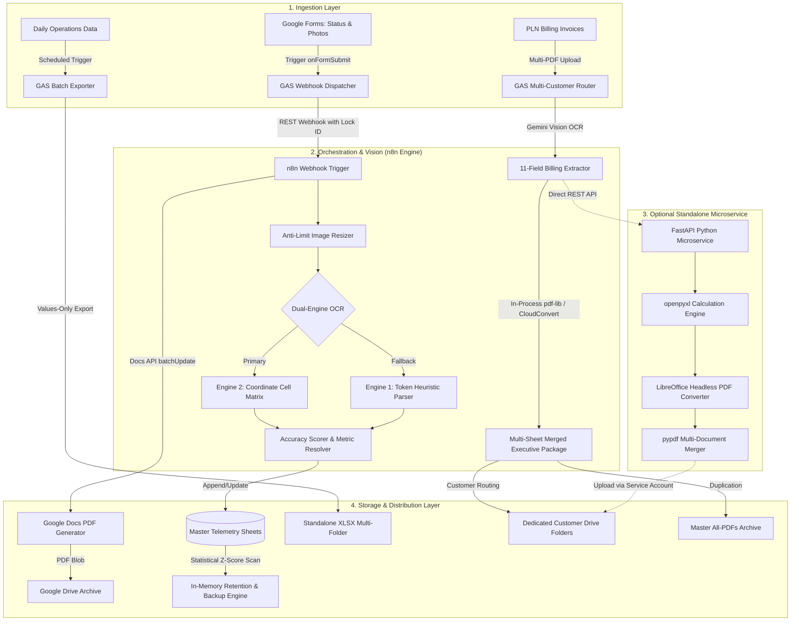

# 🚀 Enterprise Infrastructure Automation & Telemetry Data Pipeline

[](https://n8n.io/)
[](https://workspace.google.com/)
[](https://ai.google.dev/)
[](https://fastapi.tiangolo.com/)
[](LICENSE)
[](https://github.com/pandamanaaja/telemetry-workflow-automation/actions/workflows/ci.yml)

Production-tested, enterprise-grade workflow automation for **industrial transmitter telemetry ingestion**, **field maintenance report generation**, **large-scale anomaly detection**, **multimodal utility billing OCR**, and **automated multi-customer data retention pipelines**.

---

## 🏗 System Architecture



---

## 💎 Key Components & Engineering Highlights

### 1. 📡 Industrial Telemetry OCR Pipeline (`n8n-workflows/01-industrial-telemetry-ocr.json`)
* **Dual-Engine OCR with Dynamic Fallback**:
  * Utilizes primary coordinate-based relative box mapping (`Static Cell Matrix`) for standardized telemetry display panels.
  * Dynamically evaluates confidence scores and triggers fallback token scanning if the primary score falls below 88% or confidence is low.
* **Domain-Specific Ambiguity Correction**:
  * Context-aware character disambiguation: safely converts `O/Q/D` $\rightarrow$ `0`, `I/l` $\rightarrow$ `1`, `S` $\rightarrow$ `5`, and `B` $\rightarrow$ `8` only inside numeric metric fields while preserving textual unit labels.
  * Hard-locks engineering physical limits (e.g., Driver Power Amplifier `DPA1` clamped to `0.3–1.2A`, `DPA2` to `3.5–5.0A`, and Final Power Amplifier `FPA1–8` to `7.0–10.8A`).
* **Concurrency Guard & Auto-Cleanup**:
  * Batches image downloads in small slices (1–3 images per cycle) with adaptive sleep intervals to strictly adhere to OCR and Drive API rate limits.
  * Permanently purges temporary uploaded raw images from Drive upon successful sheet insertion, saving cloud storage quotas.

### 2. 📑 Dynamic Document & PDF Report Generator (`n8n-workflows/02-site-visit-report-autocrat.json`)
* Replaces legacy Autocrat add-ons with a resilient, native Google Docs API `batchUpdate` engine.
* **Smart Adaptive Image Layout**: Calculates the number of uploaded site documentation photos and dynamically resizes image bounding boxes (`magnitude: PT`) to guarantee clean, unclipped table cells in the exported PDF.
* Exports evaluated PDF blobs to designated Google Drive distribution folders and posts confirmation payloads back to the caller.

### 3. ⚡ Multi-Customer PLN Billing Pipeline (GAS v16.5, n8n v16 Local pdf-lib, & Gemini OCR)
* **PLN Auto Report Engine v16.5 (`apps-script/02-report-generators/pln_auto_report_v16_engine.js`)**:
  * **Dual-Format Continuity Scanner**: Automatically scans previous month meter stands across both Google Sheets and Microsoft Excel (`.xlsx`/`.xls`) files via virtual Drive API conversion.
  * **SCTV 100% Chain Continuity**: Restores previous month meter stands directly into calculation sheets (`SCTV Hitung`) with multi-tier margin validation (Rp 100rb - 500rb based on days).
  * **Deadlock-Free `onEdit` Approval**: Replaces problematic single-flag triggers with dual-mode evaluation (`e.value === 'TRUE'` or `range.getValue() === true`), preventing UI deadlocks.
  * **Automatic Trigger Cleanup**: Auto-removes event listeners upon report finalization to stay safely under Google's 20-trigger quota limit.
  * **Auto Signature Technician Placement**: Programmatically positions PNG signature graphics with exact coordinate offsets (`D36`, 102x65px) without crashing if assets are absent.
* **Zero-Dependency Local `pdf-lib` Multi-Sheet Merger v16.0 (`n8n-workflows/07-pln-finalize-pdf-local-pdflib.json`)**:
  * Merges up to 4 distinct PDF documents in a single atomic pass: `TN` (portrait), `PERBANDINGAN` (landscape), `SCTV HITUNG` (calculation sheet), and the original supplier invoice.
  * In-process single-page slicing ensures zero instruction page leakage.
* **Sequential Gemini Multimodal OCR & Sheet Builder (`n8n-workflows/05-pln-gemini-ocr-sheet-builder.json`)**:
  * Multimodal extraction of 11 critical utility billing fields (`LWBP`, `WBP`, `kVArh`, tariff power, period, payable amount) with error-tolerant sequential queuing.

### 4. 🐍 Standalone Python Backend Microservice (`standalone-backend/`)
* **Zero Apps Script Quota Limitations**:
  * High-performance standalone Python FastAPI microservice built for VPS or Docker deployments.
  * Executes openpyxl template synthesis, headless LibreOffice PDF conversions, and PyPDF document merges in **3–6 seconds** per report (eliminating Google's 6-minute execution limits).
  * Includes complete production `Dockerfile`, `docker-compose.yml`, systemd daemon unit, and reverse-proxy Nginx configuration.

### 5. 🔍 High-Performance Data Processing & Anomaly Scanner (`apps-script/`)
* **Statistical Outlier Detection (`01-master-metering/anomaly_detection.js`)**:
  * Rolling window ($N=3$) Z-Score algorithm ($\mu \pm 2.5\sigma$) with minimum absolute threshold filters ($\Delta \ge 2.0$) to highlight anomalous telemetry spikes.
  * Batch visual alerts via a single `range.setBackgrounds()` API call.
* **Zero-Lag In-Memory Backup Engine (`01-master-metering/fast_backup_engine.js`)**:
  * Eliminates slow row-by-row deletion loops by filtering data in-memory and batch writing with `clearContent()` + `setValues()`.
* **Multi-Criteria Gmail Archival Engine (`05-gmail-automation/email_sorting_engine.js`)**:
  * Implements query exclusion generators and execution time guards (`MAX_EXEC_TIME_MS = 240000`) to organize, label, and archive hundreds of daily system dispatches.

---

## 📁 Repository Structure

```text
telemetry-workflow-automation/
├── .github/
│   └── workflows/
│       └── ci.yml                             # Automated GitHub Actions test runner
├── .gitignore
├── LICENSE
├── package.json                               # Node.js test suite configuration
├── README.md                                  # Enterprise architecture & implementation guide
│
├── n8n-workflows/                             # Production n8n automation workflows
│   ├── 01-industrial-telemetry-ocr.json       # Telemetry OCR & metric parsing workflow
│   ├── 02-site-visit-report-autocrat.json     # Dynamic Docs-to-PDF report generator
│   ├── 03-cleaning-report-generator.json      # Maintenance report & callback synchronizer
│   ├── 04-pln-bill-ocr-extractor.json         # Multimodal PLN billing OCR & auto-recap workflow
│   ├── 05-pln-gemini-ocr-sheet-builder.json   # Multi-customer PLN Gemini OCR & auto report builder
│   ├── 06-pln-finalize-pdf-cloudconvert.json  # CloudConvert 3-PDF merger variant
│   ├── 07-pln-finalize-pdf-local-pdflib.json  # Local pdf-lib 3-PDF merger (v14.6)
│   └── 07-pln-finalize-pdf-local-pdflib.json # Local pdf-lib 4-PDF merger with Auto Hitung (v16.0)
│
├── apps-script/                               # Google Apps Script enterprise modules
│   ├── 01-master-metering/
│   │   ├── anomaly_detection.js               # Z-Score outlier & missing cell scanner
│   │   └── fast_backup_engine.js              # High-speed in-memory retention engine
│   ├── 02-report-generators/
│   │   ├── baseline_pdf_generator.js          # Incremental pointer-based PDF report generator
│   │   ├── pln_auto_report_v14_engine.js      # Multi-customer PLN auto report v14.8
│   │   ├── pln_auto_report_v16_engine.js      # Multi-customer PLN auto report v16.5 (Continuity + SCTV Hitung)
│   │   ├── pln_billing_report_builder.js      # Automated PLN billing executive report builder
│   │   ├── pln_single_page_pdf_exporter.js    # Single-page A4 Portrait/Landscape GID PDF exporter
│   │   └── xlsx_multi_sheet_exporter.js       # Scheduled daily/weekly/monthly XLSX exporter
│   ├── 03-data-deduplication/
│   │   ├── duplicate_processor.js             # Composite-key deduplication processor
│   │   └── master_response_dedup_checker.js   # Master response deduplication and normalization
│   ├── 04-schedule-operations/
│   │   └── technician_schedule_matrix.js      # Roster matrix normalizer & transpose generator
│   ├── 05-gmail-automation/
│   │   └── email_sorting_engine.js            # Automated multi-criteria email routing engine
│   ├── 06-form-webhooks/
│   │   ├── cleaning_report_webhook.js         # Form submission dispatcher & callback
│   │   ├── pln_form_submit.js                 # Single PLN invoice form webhook
│   │   ├── pln_form_submit_v14_webhook.js     # Multi-PDF PLN form submit dispatcher
│   │   ├── site_visit_report_dispatcher.js    # Site visit inspection dispatcher with Docs API
│   │   └── telemetry_form_submit.js           # Image extractor and telemetry webhook dispatcher
│   └── 07-drive-maintenance/
│       └── auto_delete_images_except.js       # Server-side image cleanup with folder exclusion
│
├── standalone-backend/                        # Standalone Python microservice (VPS / Docker)
│   ├── config.py                              # Customer directory & API settings
│   ├── Dockerfile                             # Container build file with LibreOffice Headless
│   ├── docker-compose.yml                     # Production Docker Compose orchestration
│   ├── main.py                                # FastAPI REST endpoint & health monitor
│   ├── requirements.txt                       # Python dependencies (openpyxl, pypdf, fastapi)
│   ├── report_engine.py                       # Excel synthesis, LibreOffice export, & PDF merge
│   ├── README.md                              # Standalone server setup & deployment documentation
│   ├── nginx/
│   │   └── pln-api.conf                       # Reverse proxy configuration
│   └── systemd/
│       └── pln-report.service                 # Linux systemd background daemon service
│
├── src/                                       # Core algorithm modules for Node.js test runner
│   ├── anomalyMath.js                         # Statistical calculations & anomaly thresholds
│   ├── shiftConverter.js                      # Shift code normalizers & composite key builder
│   └── telemetryParser.js                     # OCR token heuristical disambiguation engine
│
└── tests/                                     # Automated test suites (node --test)
    ├── anomaly-detection.test.js              # Unit tests for statistical anomaly detection
    ├── n8n-workflows.test.js                  # Structural integrity tests for all n8n workflows
    ├── ocr-heuristics.test.js                 # OCR character correction and bounds tests
    └── shift-matrix.test.js                   # Schedule matrix & key generation tests
```

---

## 🛠 Getting Started

### 1. Deploying n8n Workflows
1. In your **n8n** console, navigate to **Workflows** $\rightarrow$ **Add Workflow** $\rightarrow$ **Import from File**.
2. Select any JSON workflow from the `n8n-workflows/` directory (e.g. `07-pln-finalize-pdf-local-pdflib.json`).
3. Configure the OAuth2 credentials for:
   * **Google Drive OAuth2**
   * **Google Docs OAuth2**
   * **Google Sheets OAuth2**
   * **Google Gemini API**
4. Update placeholder values:
   * Replace `YOUR_OCR_SPACE_API_KEY` with your OCR.space API key.
   * Replace `YOUR_TELEMETRY_SPREADSHEET_ID` and `YOUR_PLN_MASTER_SPREADSHEET_ID` with your Google Sheet IDs.
   * Replace `YOUR_PLN_REPORT_WEBHOOK_SECRET` and `YOUR_PLN_FINALIZE_TRIGGER_TOKEN` with your secure tokens.
5. Toggle workflow to **Active**.

### 2. Installing Google Apps Script
1. Open your target Google Spreadsheet.
2. Navigate to **Extensions** $\rightarrow$ **Apps Script**.
3. Create new script files corresponding to the modules in `apps-script/` (such as `pln_auto_report_v16_engine.js`).
4. Update the configuration block at the top of each script (e.g., `MASTER_ID`, `ALL_PDFS_FOLDER_ID`, `REPORT_SECRET`).
5. Set up form submit triggers via `ScriptApp.newTrigger('onFormSubmit').forSpreadsheet(ss).onFormSubmit().create()`.

### 3. Running the Standalone Python Microservice (Optional)
```bash
# Clone and enter backend directory
cd standalone-backend

# Option A: Run via Docker
docker compose up -d --build

# Option B: Run locally on Linux VPS
python3 -m venv venv
source venv/bin/activate
pip install -r requirements.txt
uvicorn main:app --host 0.0.0.0 --port 8000
```

---

## 🧪 Automated Testing

This repository includes continuous integration testing via GitHub Actions:
```bash
npm test
```
The test suite validates:
* **Mathematical bounds and rolling Z-score anomaly detection**.
* **Character-level heuristic disambiguation** (converting OCR visual confusions while safeguarding units).
* **Schedule matrix transposition and composite-key generation**.
* **JSON schema, node definitions, and connection graph integrity** across all n8n workflow configurations.

---

## 🔒 Security & Data Sanitization
All company-specific identifiers, proprietary internal server domains, OAuth token credentials, API keys, customer names, and employee personal data have been sanitized with generic placeholders (`YOUR_*`) for public portfolio demonstration and safety.
