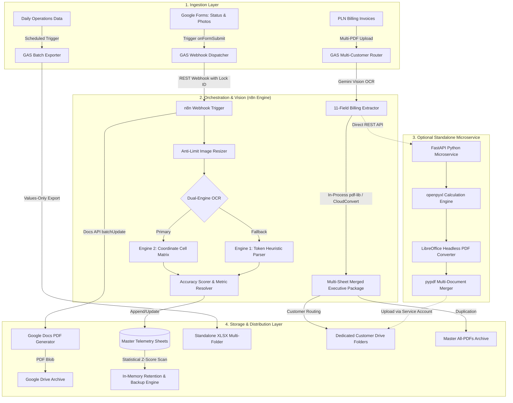

# 🚀 Enterprise Infrastructure Automation & Telemetry Data Pipeline

[](https://n8n.io/)
[](https://workspace.google.com/)
[](https://ai.google.dev/)
[](https://fastapi.tiangolo.com/)
[](LICENSE)
[](https://github.com/pandamanaaja/telemetry-workflow-automation/actions/workflows/ci.yml)

Production-tested, enterprise-grade workflow automation for **industrial transmitter telemetry ingestion**, **field maintenance report generation**, **large-scale anomaly detection**, **multimodal utility billing OCR**, and **automated multi-customer data retention pipelines**.

---

## 🏗 System Architecture



---

## 💎 Key Components & Engineering Highlights

### 1. 📡 Industrial Telemetry OCR Pipeline (`n8n-workflows/01-industrial-telemetry-ocr.json`)
* **Dual-Engine OCR with Dynamic Fallback**:
  * Utilizes primary coordinate-based relative box mapping (`Static Cell Matrix`) for standardized telemetry display panels.
  * Dynamically evaluates confidence scores and triggers fallback token scanning if the primary score falls below 88% or confidence is low.
* **Domain-Specific Ambiguity Correction**:
  * Context-aware character disambiguation: safely converts `O/Q/D` $\rightarrow$ `0`, `I/l` $\rightarrow$ `1`, `S` $\rightarrow$ `5`, and `B` $\rightarrow$ `8` only inside numeric metric fields while preserving textual unit labels.
  * Hard-locks engineering physical limits (e.g., Driver Power Amplifier `DPA1` clamped to `0.3–1.2A`, `DPA2` to `3.5–5.0A`, and Final Power Amplifier `FPA1–8` to `7.0–10.8A`).
* **Concurrency Guard & Auto-Cleanup**:
  * Batches image downloads in small slices (1–3 images per cycle) with adaptive sleep intervals to strictly adhere to OCR and Drive API rate limits.
  * Permanently purges temporary uploaded raw images from Drive upon successful sheet insertion, saving cloud storage quotas.

### 2. 📑 Dynamic Document & PDF Report Generator (`n8n-workflows/02-site-visit-report-autocrat.json`)
* Replaces legacy Autocrat add-ons with a resilient, native Google Docs API `batchUpdate` engine.
* **Smart Adaptive Image Layout**: Calculates the number of uploaded site documentation photos and dynamically resizes image bounding boxes (`magnitude: PT`) to guarantee clean, unclipped table cells in the exported PDF.
* Exports evaluated PDF blobs to designated Google Drive distribution folders and posts confirmation payloads back to the caller.

### 3. ⚡ Multi-Customer PLN Billing Pipeline (GAS v16.5, n8n v16 Local pdf-lib, & Gemini OCR)
* **PLN Auto Report Engine v16.5 (`apps-script/02-report-generators/pln_auto_report_v16_engine.js`)**:
  * **Dual-Format Continuity Scanner**: Automatically scans previous month meter stands across both Google Sheets and Microsoft Excel (`.xlsx`/`.xls`) files via virtual Drive API conversion.
  * **Multi-Tier Meter Chain Continuity**: Restores previous month meter stands directly into automated reconciliation sheets with multi-tier consumption variance validation (e.g. dynamically scaled margins based on operating billing days).
  * **Deadlock-Free `onEdit` Approval**: Replaces problematic single-flag triggers with dual-mode evaluation (`e.value === 'TRUE'` or `range.getValue() === true`), preventing UI deadlocks.
  * **Automatic Trigger Cleanup**: Auto-removes event listeners upon report finalization to stay safely under Google's 20-trigger quota limit.
  * **Auto Signature Technician Placement**: Programmatically positions PNG signature graphics with exact coordinate offsets (`D36`, 102x65px) without crashing if assets are absent.
* **Zero-Dependency Local `pdf-lib` Multi-Sheet Merger v16.0 (`n8n-workflows/07-pln-finalize-pdf-local-pdflib.json`)**:
  * Merges up to 4 distinct PDF documents in a single atomic pass: `TN` (Payment Voucher portrait), `PERBANDINGAN` (3-Month Comparison landscape), `CALCULATION` (Reconciliation sheet), and the original supplier invoice.
  * In-process single-page slicing ensures zero instruction page leakage.
* **Sequential Gemini Multimodal OCR & Sheet Builder (`n8n-workflows/05-pln-gemini-ocr-sheet-builder.json`)**:
  * Multimodal extraction of 11 critical utility billing fields (`LWBP`, `WBP`, `kVArh`, tariff power, period, payable amount) with error-tolerant sequential queuing.

### 4. 🐍 Standalone Python Backend Microservice (`standalone-backend/`)
* **Zero Apps Script Quota Limitations**:
  * High-performance standalone Python FastAPI microservice built for VPS or Docker deployments.
  * Executes openpyxl template synthesis, headless LibreOffice PDF conversions, and PyPDF document merges in **3–6 seconds** per report (eliminating Google's 6-minute execution limits).
  * Includes complete production `Dockerfile`, `docker-compose.yml`, systemd daemon unit, and reverse-proxy Nginx configuration.

### 5. 🔍 High-Performance Data Processing & Anomaly Scanner (`apps-script/`)
* **Multi-Sheet Statistical Master Metering Suite (`01-master-metering/master_metering_suite.js`)**:
  * Unified enterprise suite v17.0 executing across all workbook sheets simultaneously (`MASTER METERING`, `BACKUP_BULAN_...`, `BACKUP_HARI_...`).
  * **Pure Statistical Pattern Engine**: 100% free from theoretical physics formulas; employs median anchors, Min-Max bounds, 10x/100x/1000x typo detection, 0.1x decimal shift recovery, and moving neighbor deltas.
  * **Naturally Negative Parameter Protection**: Protects negative transmission parameters (`PER`, `GRID VOLTAGE TX A & B`) from `Math.abs()` inversion, while correcting typo positive inputs (e.g. `107.79` -> `-107.79`).
  * **Anti-Batavia 1899 Shift Time Restoration**: Strips historical +07:25 Batavia timezone offset distortion and locks Plain Text (`@`) shift intervals (`7:00`, `1:00`, `23:00`).
  * **Cut-Off & In-Memory Purge Archival**: Copies records to dedicated backup sheets, activates the new tab, and purges archived rows from the master sheet to maintain lightweight operational workbooks.
* **Master Response MET Suite (`01-master-metering/master_response_met_suite.js`)**:
  * Complete industrial audit, automated repair, and dynamic sheet backup suite v8.5 across 168 telemetry columns.
  * **Zero-Touch Metadata Protection**: Columns `Timestamp`, `Nama Teknisi`, and `Jam Metering` are strictly excluded from batch writes (`colFixed > 0` selective targeting), completely preventing Google Sheets epoch formatting glitches (`12/30/1899`).
  * **1-Click Jam Metering Restoration**: Dedicated `kembalikanFormatJamMeteringAsli()` utility restoring native `HH:mm` time formatting.
  * **Zero-Variance Protection**: Automatically recognizes static operational constants (e.g. Battery Counter, Coolant SV, Standby RF) where $\max - \min \approx 0$ as legitimate signals, preventing false anomaly flags.
  * **Recommendation Notes**: Attaches detailed cell notes indicating exact *Nilai Rekomendasi* (recommended normal values) and maintains a historical audit trail (*Nilai Lama* $\rightarrow$ *Nilai Baru*) upon auto-repair.
  * **PLN Electrical Standard Validation**: Implements strict checks for power factor ($\cos\varphi \ge 0.85$), frequency ($50\text{ Hz} \pm 1\%$), voltage thresholds (220V/380V), and 3-Phase active power correlation ($P = 3 \times V_{\text{avg}} \times I_{\text{avg}} \times \cos\varphi / 1000$).
  * **Automated Sheet Creation & Archival**: 1-click dynamic generation of monthly/daily archive tabs (`BACKUP_BULAN_YYYYMM`, `BACKUP_TGL_YYYYMMDD`, `BACKUP_LENGKAP_...`) with automatic header copying, row freezing, and in-memory master row purging.
* **Statistical Outlier Detection (`01-master-metering/anomaly_detection.js`)**:
  * Rolling window ($N=3$) Z-Score algorithm ($\mu \pm 2.5\sigma$) with minimum absolute threshold filters ($\Delta \ge 2.0$) to highlight anomalous telemetry spikes.
  * Batch visual alerts via a single `range.setBackgrounds()` API call.
* **Zero-Lag In-Memory Backup Engine (`01-master-metering/fast_backup_engine.js`)**:
  * Eliminates slow row-by-row deletion loops by filtering data in-memory and batch writing with `clearContent()` + `setValues()`.
* **Multi-Criteria Gmail Archival Engine (`05-gmail-automation/email_sorting_engine.js`)**:
  * Implements query exclusion generators and execution time guards (`MAX_EXEC_TIME_MS = 240000`) to organize, label, and archive hundreds of daily system dispatches.

### 6. 📊 High-Speed Telemetry Multi-Template Excel Backup Engine (`n8n-workflows/08-telemetry-excel-multitemplate-backup.json` & `apps-script/01-master-metering/telemetry_excel_multitemplate_backup.js`)
* **Sub-Second Payload Dispatch (<0.3s)**: Eliminates Google Apps Script 360-second execution timeouts on massive workbooks (>30 MB, 40+ tabs) by extracting display values directly into memory and dispatching JSON payloads to n8n asynchronously (`responseMode: onReceived`).
* **Visual Switch Dynamic Routing**: Evaluates report metadata (`reportType: DAILY | WEEKLY | MONTHLY`) and routes data to isolated, pre-formatted Google Drive master templates:
  * **Daily (Harian)**: 28 columns (00:00 to 22:00 readings), 3,494 merged cells.
  * **Weekly (Mingguan)**: 18 columns (7 days + Average), 2,312 merged cells (zero leftover daily time columns).
  * **Monthly (Bulanan)**: Dynamic auto-detection between **Monthly 4W** (12 columns, 4 operating weeks) and **Monthly 5W** (14 columns, 5 operating weeks) based on workbook tab topology, preserving up to 1,845 merged cells.
* **100% Visual & Formatting Fidelity**: Injects values into cloned single-sheet templates and exports genuine `.xlsx` files preserving exact font metrics, background fills, borders, and complex merged cell structures.
* **Parallel Dual-Drive Storage & Auto-Purge**: Simultaneously uploads exported `.xlsx` files to two distinct Google Drive backup directories in parallel, then permanently purges the temporary cloned Google Spreadsheet via Drive API (`HTTP 204 No Content`).
* **Automated Schedule Triggers in n8n**: Offloads automated scheduling from Apps Script to n8n Schedule Triggers (Daily at 05:00 WIB, Weekly on Sunday at 06:00 WIB, Monthly on 7th at 07:00 WIB) with direct Google Sheets REST API ingestion (0.3s), completely eliminating 360-second headless execution timeouts on 30MB+ spreadsheets while keeping the Google Sheets UI menu for on-demand manual triggers.

---

## 📖 Domain Nomenclature & Industrial Terminology

To assist code reviewers and prospective engineering teams, this section outlines domain-specific terms across industrial broadcast telemetry, high-voltage utility metering, and mission-critical 24/7 site operations:

### 1. ⚡ High-Voltage Electrical Utility Metering (PLN Industrial Tariffs)
| Term | Full Designation | Engineering Context & Definition |
| :--- | :--- | :--- |
| **LWBP** | *Luar Waktu Beban Puncak* | **Off-Peak Energy Consumption**: Standard baseline tariff period (22:00–17:00 WIB) for industrial utility billing. |
| **WBP** | *Waktu Beban Puncak* | **Peak Demand Window**: Premium tariff period (17:00–22:00 WIB) requiring higher per-kWh rates to manage national grid loads. |
| **kVArh** | *kilo-Volt-Ampere reactive hour* | **Reactive Energy Consumption**: Measures inductive magnetizing load; power factor must maintain $\cos \varphi \ge 0.85$ to prevent grid penalty charges. |
| **Cos Phi ($\cos\varphi$)** | *Power Factor* | **Load Efficiency Ratio**: Electrical displacement power factor; maintained $\ge 0.85$ under PLN standard. |
| **PTOT** | *Total Active Power* | **3-Phase Active Power**: Total active power demand in kW, cross-validated via $P = (3 \times V_{\text{avg}} \times I_{\text{avg}} \times \cos\varphi) / 1000$. |
| **TN** | *Tanda Nota* | **Formal Payment Voucher / Executive Summary**: Standardized 1-page executive verification slip accompanying utility invoices for corporate finance sign-off. |
| **Meter Continuity** | *Chain Stand Reconciliation* | Algorithmic guarantee that previous month ending meter readings automatically and immutably match current month starting readings across multi-sheet workbooks. |

### 2. 📡 Industrial Broadcast & RF Telemetry Hardware
| Parameter | Full Name | Operational Significance |
| :--- | :--- | :--- |
| **IVM & SCTV** | *Indosiar & Surya Citra Televisi* | Co-located national television broadcast transmission stations sharing electrical grid panels and transmitter towers. |
| **DPA** | *Driver Power Amplifier* | Initial solid-state RF gain stage driving transmission antennas (standard current draw: 0.3–5.0 A). |
| **FPA** | *Final Power Amplifier* | High-capacity output power amplifier modules (FPA 1–8; standard current draw: 7.0–10.8 A). |
| **OP** | *Output Power* | Real forward electromagnetic transmission power delivered to the antenna array. |
| **RP** | *Reflected Power* | Power reflected back from the antenna feeder system; monitored closely to prevent transmitter thermal trip or damage. |
| **PA-01 .. PA-10** | *Power Amplifier Modules* | Granular telemetry channels mapped across modular transmitter bays for real-time health grading. |
| **Waveguide Pressure** | *Waveguide Nitrogen/Air Pressure* | Pressurized dry air/nitrogen gas line for antenna waveguides; values dropping to 0.00 indicate physical enclosure puncture. |
| **Coolant SV** | *Coolant Tank Set Value* | Temperature target parameter for transmitter closed-loop liquid cooling systems; static setpoints are protected from false anomaly alarms. |
| **PER** | *Negative Telemetry Parameter* | Naturally negative operational parameters (such as bias grid voltages or error margins) correctly operating at negative values (e.g. -7 to -107V). |

### 3. 🕒 Operational Roster & Continuous Duty Codes
| Shift Code | Category | Operational Definition |
| :--- | :--- | :--- |
| **C15 / C17** | Morning Shift | Early maintenance and parameter logging cycle. |
| **C31 / C33** | Afternoon Shift | Transition and peak monitoring duty cycle. |
| **C47 / C01** | Night / Overnight Shift | Off-peak transmitter monitoring, scheduled cleanings, and automated backup exports. |
| **DT / FS / TL** | Special Status | *Dinas Tertentu* (Scheduled Assignment), *Full Shift*, or *Tugas Luar* (Off-site field intervention). |

### 4. 🕒 Historical Geodesy & Date Epochs
* **Batavia 1899 (+07:25)**: Google Sheets stores time-only values (e.g., `11:00`) as day fractions relative to epoch `December 30, 1899`. Indonesia historically utilized Batavia Mean Time (GMT+07:25:04) before transitioning to GMT+07:00 (WIB). Converting time cells without stripping the date epoch can cause a 25-minute timezone distortion (e.g., `11:25`) or cause cells to render raw epoch dates (`12/30/1899`).

### 5. 🛠 Data Architecture & Pipeline Principles
* **Zero-Touch Metadata Protection**: Preserves metadata columns (`Timestamp`, `Nama Teknisi`, `Jam Metering`) from being overwritten by batch anomaly repairs, maintaining exact spreadsheet number formatting (`HH:mm`).
* **Zero-Variance Protection**: Automatically recognizes invariant setpoint columns where $\max - \min \approx 0$ (such as battery counters or SV targets) as valid static operations, eliminating false anomaly flags.
* **GID**: The unique numeric identifier assigned to each worksheet tab inside a Google Spreadsheet URL (`#gid=...`).
* **Autocrat Replacement**: Eliminates slow third-party Google Workspace add-ons by orchestrating native Google Docs API `batchUpdate` transactions in n8n.

### 6. 📊 Multi-Template Cadence
* **4W (4-Week Cadence - 12 Columns)**: Shorter monthly billing cycles containing 4 monitoring weeks; dynamically routed to 12-column master templates.
* **5W (5-Week Cadence - 14 Columns)**: Extended monthly cycles spanning 5 calendar weeks; dynamically routed to 14-column master templates upon detecting a `MINGGU 5` tab in the target workbook.

## 📁 Repository Structure

```text
telemetry-workflow-automation/
├── .github/
│   └── workflows/
│       └── ci.yml                             # Automated GitHub Actions test runner
├── .gitignore
├── LICENSE
├── package.json                               # Node.js test suite configuration
├── README.md                                  # Enterprise architecture & implementation guide
│
├── n8n-workflows/                             # Production n8n automation workflows
│   ├── 01-industrial-telemetry-ocr.json       # Telemetry OCR & metric parsing workflow
│   ├── 02-site-visit-report-autocrat.json     # Dynamic Docs-to-PDF report generator
│   ├── 03-cleaning-report-generator.json      # Maintenance report & callback synchronizer
│   ├── 04-pln-bill-ocr-extractor.json         # Multimodal PLN billing OCR & auto-recap workflow
│   ├── 05-pln-gemini-ocr-sheet-builder.json   # Multi-customer PLN Gemini OCR & auto report builder
│   ├── 06-pln-finalize-pdf-cloudconvert.json  # CloudConvert 3-PDF merger variant
│   ├── 07-pln-finalize-pdf-local-pdflib.json  # Local pdf-lib 4-PDF merger with Auto Hitung (v16.0)
│   └── 08-telemetry-excel-multitemplate-backup.json # High-speed multi-template Excel backup engine
│
├── apps-script/                               # Google Apps Script enterprise modules
│   ├── 01-master-metering/
│   │   ├── master_response_met_suite.js       # [RECOMMENDED] Master response MET audit, PLN compliance, & auto-sheet backup (v8.5)
│   │   ├── master_metering_suite.js           # Multi-sheet statistical pattern engine & shift recovery (v17.0)
│   │   ├── anomaly_detection.js               # [Legacy Standalone] Z-Score outlier & missing cell scanner
│   │   ├── fast_backup_engine.js              # [Legacy Standalone] High-speed in-memory retention engine
│   │   └── telemetry_excel_multitemplate_backup.js # Multi-template fast Excel backup & cron triggers
│   ├── 02-report-generators/
│   │   ├── pln_auto_report_v16_engine.js      # [RECOMMENDED v16.7] Multi-customer PLN auto report (Continuity + SCTV Hitung)
│   │   ├── pln_auto_report_v14_engine.js      # [Legacy v14.8] Multi-customer PLN auto report
│   │   ├── baseline_pdf_generator.js          # Incremental pointer-based PDF report generator
│   │   ├── pln_billing_report_builder.js      # Automated PLN billing executive report builder
│   │   ├── pln_single_page_pdf_exporter.js    # Single-page A4 Portrait/Landscape GID PDF exporter
│   │   └── xlsx_multi_sheet_exporter.js       # Scheduled daily/weekly/monthly XLSX exporter
│   ├── 03-data-deduplication/
│   │   ├── duplicate_processor.js             # Composite-key deduplication processor
│   │   └── master_response_dedup_checker.js   # Master response deduplication and normalization
│   ├── 04-schedule-operations/
│   │   └── technician_schedule_matrix.js      # Roster matrix normalizer & transpose generator
│   ├── 05-gmail-automation/
│   │   └── email_sorting_engine.js            # Automated multi-criteria email routing engine
│   ├── 06-form-webhooks/
│   │   ├── cleaning_report_webhook.js         # Form submission dispatcher & callback
│   │   ├── pln_form_submit.js                 # Single PLN invoice form webhook
│   │   ├── pln_form_submit_v14_webhook.js     # Multi-PDF PLN form submit dispatcher
│   │   ├── site_visit_report_dispatcher.js    # Site visit inspection dispatcher with Docs API
│   │   └── telemetry_form_submit.js           # Image extractor and telemetry webhook dispatcher
│   └── 07-drive-maintenance/
│       └── auto_delete_images_except.js       # Server-side image cleanup with folder exclusion
│
├── standalone-backend/                        # Standalone Python microservice (VPS / Docker)
│   ├── config.py                              # Customer directory & API settings
│   ├── Dockerfile                             # Container build file with LibreOffice Headless
│   ├── docker-compose.yml                     # Production Docker Compose orchestration
│   ├── main.py                                # FastAPI REST endpoint & health monitor
│   ├── requirements.txt                       # Python dependencies (openpyxl, pypdf, fastapi)
│   ├── report_engine.py                       # Excel synthesis, LibreOffice export, & PDF merge
│   ├── README.md                              # Standalone server setup & deployment documentation
│   ├── nginx/
│   │   └── pln-api.conf                       # Reverse proxy configuration
│   └── systemd/
│       └── pln-report.service                 # Linux systemd background daemon service
│
├── src/                                       # Core algorithm modules for Node.js test runner
│   ├── anomalyMath.js                         # Statistical calculations & anomaly thresholds
│   ├── shiftConverter.js                      # Shift code normalizers & composite key builder
│   └── telemetryParser.js                     # OCR token heuristical disambiguation engine
│
└── tests/                                     # Automated test suites (node --test)
    ├── anomaly-detection.test.js              # Unit tests for statistical anomaly detection
    ├── master-response-met.test.js            # Unit tests for master response MET suite v8.5
    ├── n8n-workflows.test.js                  # Structural integrity tests for all n8n workflows
    ├── ocr-heuristics.test.js                 # OCR character correction and bounds tests
    └── shift-matrix.test.js                   # Schedule matrix & key generation tests
```

---

## 🛠 Getting Started

### 1. Deploying n8n Workflows
1. In your **n8n** console, navigate to **Workflows** $\rightarrow$ **Add Workflow** $\rightarrow$ **Import from File**.
2. Select any JSON workflow from the `n8n-workflows/` directory (e.g. `07-pln-finalize-pdf-local-pdflib.json`).
3. Configure the OAuth2 credentials for:
   * **Google Drive OAuth2**
   * **Google Docs OAuth2**
   * **Google Sheets OAuth2**
   * **Google Gemini API**
4. Update placeholder values:
   * Replace `YOUR_OCR_SPACE_API_KEY` with your OCR.space API key.
   * Replace `YOUR_TELEMETRY_SPREADSHEET_ID` and `YOUR_PLN_MASTER_SPREADSHEET_ID` with your Google Sheet IDs.
   * Replace `YOUR_PLN_REPORT_WEBHOOK_SECRET` and `YOUR_PLN_FINALIZE_TRIGGER_TOKEN` with your secure tokens.
5. Toggle workflow to **Active**.

### 2. Installing Google Apps Script
1. Open your target Google Spreadsheet.
2. Navigate to **Extensions** $\rightarrow$ **Apps Script**.
3. **Module Selection & Isolation**:
   * **For Master Response & Telemetry Audit**: Deploy [`master_response_met_suite.js`](apps-script/01-master-metering/master_response_met_suite.js) (All-in-one v8.5 with non-KWH scanning, zero-touch jam protection, and auto-sheet backup). Do **not** deploy legacy standalone modules (`anomaly_detection.js` or `fast_backup_engine.js`) alongside it to prevent global identifier collisions.
   * **For PLN Multi-Customer Auto Reporting**: Deploy [`pln_auto_report_v16_engine.js`](apps-script/02-report-generators/pln_auto_report_v16_engine.js) (v16.7). Do not deploy legacy `v14` alongside `v16`.
4. Update the configuration block at the top of the deployed script (e.g., `SOURCE_ID`, `TARGET_ID`, `MASTER_ID`, `ALL_PDFS_FOLDER_ID`).
5. Set up form submit triggers via `ScriptApp.newTrigger('onFormSubmit').forSpreadsheet(ss).onFormSubmit().create()` where applicable.

### 3. Running the Standalone Python Microservice (Optional)
```bash
# Clone and enter backend directory
cd standalone-backend

# Option A: Run via Docker
docker compose up -d --build

# Option B: Run locally on Linux VPS
python3 -m venv venv
source venv/bin/activate
pip install -r requirements.txt
uvicorn main:app --host 0.0.0.0 --port 8000
```

---

## 🧪 Automated Testing

This repository includes continuous integration testing via GitHub Actions:
```bash
npm test
```
The test suite validates:
* **Mathematical bounds and rolling Z-score anomaly detection**.
* **Character-level heuristic disambiguation** (converting OCR visual confusions while safeguarding units).
* **Schedule matrix transposition and composite-key generation**.
* **JSON schema, node definitions, and connection graph integrity** across all n8n workflow configurations.

---

## 🔒 Security & Data Sanitization
All company-specific identifiers, proprietary internal server domains, OAuth token credentials, API keys, customer names, and employee personal data have been sanitized with generic placeholders (`YOUR_*`) for public portfolio demonstration and safety.
