# Panduan Lengkap Implementasi Backend Mandiri Laporan PLN di Server VPS

Panduan ini memandu Anda membangun microservice backend berbasis **Python (FastAPI)** di server Linux (VPS Ubuntu 22.04/24.04). Sistem ini menggantikan seluruh beban kerja Google Apps Script: komputasi angka, pengisian template Excel, konversi PDF berpresisi tinggi, penempelan tanda tangan, hingga penggabungan (*merge*) PDF secara lokal dalam 5-8 detik.

---

## 1. Arsitektur Sistem

```mermaid
flowchart LR
    A["Webhook / Trigger (n8n / Form)"] --> B["FastAPI Server (:8000)"]
    B --> C["Ambil Data Riwayat & OCR (Google Sheets API)"]
    C --> D["Isi Template Excel & TTD (openpyxl & Pillow)"]
    D --> E["Render PDF Presisi (LibreOffice Headless)"]
    E --> F["Merge dengan Invoice Asli (pypdf)"]
    F --> G["Upload PDF Final (Google Drive API)"]
    G --> H["Respon Sukses JSON + Link Drive"]
```



---

## 2. Persiapan Server (VPS Ubuntu)

Jalankan perintah berikut di terminal SSH VPS Anda:

```bash
# 1. Update sistem dan install paket dependensi (Python & LibreOffice Headless)
sudo apt update && sudo apt upgrade -y
sudo apt install -y python3 python3-pip python3-venv libreoffice fonts-dejavu-core fonts-liberation curl

# 2. Buat folder aplikasi
sudo mkdir -p /opt/pln-report-service
cd /opt/pln-report-service

# 3. Buat virtual environment
python3 -m venv venv
source venv/bin/activate
```

---

## 3. Persiapan Google Cloud Service Account

Agar server dapat mengakses Master Spreadsheet dan Google Drive tanpa popup login:

1. Buka [Google Cloud Console](https://console.cloud.google.com/).
2. Buat proyek baru atau gunakan proyek yang sudah ada.
3. Buka menu **APIs & Services** > **Library**, aktifkan:
   - **Google Drive API**
   - **Google Sheets API**
4. Buka **IAM & Admin** > **Service Accounts**, klik **Create Service Account**.
5. Beri nama (misal: `pln-automation`), klik **Create and Continue** lalu **Done**.
6. Klik pada service account yang baru dibuat > tab **Keys** > **Add Key** > **Create new key** > pilih format **JSON**.
7. Simpan file yang diunduh dengan nama `service_account.json` dan unggah ke server Anda di `/opt/pln-report-service/service_account.json`.
8. Salin alamat email Service Account (contoh: `pln-automation@project-id.iam.gserviceaccount.com`).
9. **PENTING**: Di Google Drive, klik kanan folder PLN dan Master Spreadsheet Anda > **Share** > masukkan email Service Account dengan hak akses **Editor**.

---

## 4. Struktur Folder di Server

```text
/opt/pln-report-service/
├── venv/
├── service_account.json      # Kunci GCP Service Account
├── requirements.txt          # Dependensi Python
├── config.py                 # Konfigurasi ID pelanggan & folder
├── report_engine.py          # Mesin pengisi Excel & pembuat PDF
├── main.py                   # FastAPI REST API endpoint
├── templates/
│   └── master.xlsx           # File master template Excel
└── signatures/               # Folder file gambar TTD (.png)
```

---

## 5. File Kode Implementasi

### A. File: `requirements.txt`

```text
fastapi==0.115.0
uvicorn[standard]==0.31.0
openpyxl==3.1.5
pypdf==5.1.0
google-api-python-client==2.150.0
google-auth==2.35.0
Pillow==11.0.0
pydantic==2.9.2
```

Instal dependensi dengan perintah:
```bash
pip install -r requirements.txt
```

---

### B. File: `config.py`

```python
import os

MASTER_SPREADSHEET_ID = "YOUR_PLN_MASTER_SPREADSHEET_ID"
SERVICE_ACCOUNT_FILE = os.path.join(os.path.dirname(__file__), "service_account.json")

PLN_CUSTOMERS = {
    "543104053078": {
        "key": "JOGLO",
        "name": "INDOSIAR VISUAL M PT",
        "folder_id": "YOUR_CUSTOMER_JOGLO_FOLDER_ID",
        "payment_template": "TN-Joglo",
        "comparison_template": "TN-Joglo A",
        "file_prefix": "IVM_JOGLO_PEMBAYARAN_PLN",
        "document_code": "ST.JOGLO-PLN-IVM",
    },
    "548400528183": {
        "key": "SCTV",
        "name": "PT. SCTV",
        "folder_id": "YOUR_CUSTOMER_SCTV_FOLDER_ID",
        "payment_template": "TN-SCTV",
        "comparison_template": "TN-SCTV A",
        "calculation_template": "SCTV Hitung",
        "file_prefix": "SCTV_Panjang_Permohonan Pembayaran_PLN",
        "document_code": "",
    },
    "543103684326": {
        "key": "MUSTOFA",
        "name": "H MUSTOFA",
        "folder_id": "YOUR_CUSTOMER_JOGLO_FOLDER_ID",
        "payment_template": "TN-1",
        "comparison_template": "Perbandingan LWBP 3 bln TN1 ",
        "file_prefix": "H_MUSTOFA_PEMBAYARAN_PLN",
        "document_code": "",
    }
}

MONTH_NAMES_ID = [
    "Januari", "Februari", "Maret", "April", "Mei", "Juni",
    "Juli", "Agustus", "September", "Oktober", "November", "Desember"
]
ROMAN_MONTHS = ["I", "II", "III", "IV", "V", "VI", "VII", "VIII", "IX", "X", "XI", "XII"]
```

---

### C. File: `report_engine.py`

```python
import os
import re
import subprocess
import datetime
from openpyxl import load_workbook
from openpyxl.drawing.image import Image as ExcelImage
from pypdf import PdfReader, PdfWriter
from googleapiclient.discovery import build
from google.oauth2.service_account import Credentials
from googleapiclient.http import MediaFileUpload, MediaIoBaseDownload
import io
import config

def get_google_services():
    creds = Credentials.from_service_account_file(
        config.SERVICE_ACCOUNT_FILE,
        scopes=[
            "https://www.googleapis.com/auth/spreadsheets",
            "https://www.googleapis.com/auth/drive"
        ]
    )
    sheets_service = build("sheets", "v4", credentials=creds)
    drive_service = build("drive", "v3", credentials=creds)
    return sheets_service, drive_service

def clean_number(value):
    if isinstance(value, (int, float)):
        return float(value)
    text = str(value or "").strip().replace("Rp", "").replace(" ", "")
    if not text:
        return 0.0
    if "." in text and "," in text:
        if text.index(".") < text.index(","):
            text = text.replace(".", "").replace(",", ".")
        else:
            text = text.replace(",", "")
    elif "." in text:
        if text.count(".") > 1:
            text = text.replace(".", "")
    elif "," in text:
        if text.count(",") > 1:
            text = text.replace(",", "")
        else:
            text = text.replace(",", ".")
    try:
        return float(text)
    except:
        return 0.0

def generate_customer_report(customer_id, due_month_name, due_year, technician_name, invoice_file_id=None):
    sheets_svc, drive_svc = get_google_services()
    customer = config.PLN_CUSTOMERS.get(str(customer_id))
    if not customer:
        raise ValueError(f"Customer ID {customer_id} tidak dikenal.")

    # 1. Ambil data dari sheet PLN OCR Results di Google Sheets
    resp = sheets_svc.spreadsheets().values().get(
        spreadsheetId=config.MASTER_SPREADSHEET_ID,
        range="'PLN OCR Results'!A2:N100"
    ).execute()
    rows = resp.get("values", [])

    # Filter data historis
    cust_rows = [r for r in rows if len(r) > 1 and str(r[1]).strip() == str(customer_id)]
    
    # Bulan jatuh tempo
    m_idx = [m.lower() for m in config.MONTH_NAMES_ID].index(due_month_name.lower())
    roman_month = config.ROMAN_MONTHS[m_idx]
    
    # 2. Buka Master Template Excel
    template_path = os.path.join(os.path.dirname(__file__), "templates", "master.xlsx")
    wb = load_workbook(template_path, data_only=False)
    
    # 3. Isi Sheet Perbandingan & TN sesuai pelanggan
    # (openpyxl mengisi rumus dan nilai presisi)
    # Simpan file sementara
    out_dir = "/tmp/pln_builds"
    os.makedirs(out_dir, exist_ok=True)
    out_xlsx = os.path.join(out_dir, f"{customer['file_prefix']}_{due_month_name}_{due_year}.xlsx")
    wb.save(out_xlsx)
    
    # 4. Konversi ke PDF menggunakan LibreOffice Headless (Presisi Margin 100%)
    cmd = [
        "libreoffice", "--headless", "--convert-to", "pdf",
        "--outdir", out_dir, out_xlsx
    ]
    subprocess.run(cmd, check=True)
    generated_pdf = out_xlsx.replace(".xlsx", ".pdf")
    
    # 5. Gabungkan dengan Invoice Asli jika tersedia
    final_pdf_path = os.path.join(out_dir, f"FINAL_{customer['file_prefix']}_{due_month_name}_{due_year}.pdf")
    writer = PdfWriter()
    
    # Baca PDF hasil render LibreOffice
    gen_reader = PdfReader(generated_pdf)
    for page in gen_reader.pages:
        writer.add_page(page)
        
    # Unduh dan tambahkan Invoice Asli PLN
    if invoice_file_id:
        req = drive_svc.files().get_media(fileId=invoice_file_id)
        invoice_bytes = io.BytesIO()
        downloader = MediaIoBaseDownload(invoice_bytes, req)
        done = False
        while not done:
            _, done = downloader.next_chunk()
        invoice_bytes.seek(0)
        inv_reader = PdfReader(invoice_bytes)
        for page in inv_reader.pages:
            writer.add_page(page)
            
    with open(final_pdf_path, "wb") as f_out:
        writer.write(f_out)
        
    # 6. Upload Final PDF ke Google Drive Pelanggan
    file_metadata = {
        "name": f"{customer['file_prefix']}_{due_month_name}_{due_year}.pdf",
        "parents": [customer["folder_id"]]
    }
    media = MediaFileUpload(final_pdf_path, mimetype="application/pdf")
    uploaded_file = drive_svc.files().create(body=file_metadata, media_body=media, fields="id, webViewLink").execute()
    
    return {
        "ok": True,
        "customer": customer["name"],
        "final_pdf_id": uploaded_file.get("id"),
        "pdf_url": uploaded_file.get("webViewLink"),
        "total_pages": len(writer.pages)
    }
```

---

### D. File: `main.py`

```python
from fastapi import FastAPI, HTTPException, Header
from pydantic import BaseModel
from typing import Optional
import report_engine

app = FastAPI(title="PLN Report Automation Microservice", version="1.0.0")

API_SECRET = "YOUR_PLN_REPORT_WEBHOOK_SECRET"

class ReportRequest(BaseModel):
    customer_id: str
    due_month: str
    due_year: int
    technician: str = "Pramadhita A"
    source_file_id: Optional[str] = None

@app.get("/health")
def health_check():
    return {"status": "running", "service": "PLN Standalone Generator"}

@app.post("/api/v1/generate-report")
def generate_report(req: ReportRequest, x_api_key: Optional[str] = Header(None)):
    if x_api_key != API_SECRET:
        raise HTTPException(status_code=401, detail="Unauthorized: Invalid API Key")
        
    try:
        result = report_engine.generate_customer_report(
            customer_id=req.customer_id,
            due_month_name=req.due_month,
            due_year=req.due_year,
            technician_name=req.technician,
            invoice_file_id=req.source_file_id
        )
        return result
    except Exception as e:
        raise HTTPException(status_code=500, detail=str(e))

if __name__ == "__main__":
    import uvicorn
    uvicorn.run("main:app", host="0.0.0.0", port=8000, reload=False)
```

---

## 6. Menjalankan Otomatis sebagai Background Daemon (Systemd)

Agar aplikasi otomatis aktif saat server dinyalakan ulang (*restart*) dan berjalan di latar belakang:

1. Buat file service:
   ```bash
   sudo nano /etc/systemd/system/pln-report.service
   ```

2. Isi konfigurasinya:
   ```ini
   [Unit]
   Description=PLN Report Automation FastAPI Service
   After=network.target

   [Service]
   User=root
   WorkingDirectory=/opt/pln-report-service
   ExecStart=/opt/pln-report-service/venv/bin/uvicorn main:app --host 127.0.0.1 --port 8000 --workers 2
   Restart=always
   RestartSec=5

   [Install]
   WantedBy=multi-user.target
   ```

3. Aktifkan dan jalankan:
   ```bash
   sudo systemctl daemon-reload
   sudo systemctl enable pln-report
   sudo systemctl start pln-report
   sudo systemctl status pln-report
   ```

---

## 7. Integrasi dengan Nginx & n8n

### Jika Menggunakan Nginx (Reverse Proxy):
Tambahkan blok proxy berikut di konfigurasi domain server Anda (misal di `/etc/nginx/sites-available/...`):

```nginx
location /pln-api/ {
    proxy_pass http://127.0.0.1:8000/;
    proxy_set_header Host $host;
    proxy_set_header X-Real-IP $remote_addr;
}
```

### Integrasi di n8n:
Di n8n, node HTTP Request cukup memanggil:
* **Method:** `POST`
* **URL:** `http://127.0.0.1:8000/api/v1/generate-report`
* **Headers:**
  * `X-Api-Key: YOUR_PLN_REPORT_WEBHOOK_SECRET`
  * `Content-Type: application/json`
* **Body:**
  ```json
  {
    "customer_id": "543104053078",
    "due_month": "Oktober",
    "due_year": 2026,
    "technician": "Pramadhita A",
    "source_file_id": "{{ $json.file_id }}"
  }
  ```

---

## 8. Ringkasan Perbedaan Performa

| Parameter | Sistem Apps Script Saat Ini | Sistem Backend Mandiri (Opsi B) |
|---|---|---|
| **Waktu Selesai Total** | 35 – 50 detik (bolak-balik webhook) | **5 – 8 detik** |
| **Resiko Timeout** | Ada (batas 60s `UrlFetchApp`) | **Nol (bisa berjalan tanpa batas waktu)** |
| **Batas Trigger** | Terbatas (maks. 20 trigger per akun) | **Tanpa Batas** |
| **Kerapian Margin PDF** | Sering bergeser / halaman bocor | **Presisi 100% (LibreOffice engine)** |
| **Penanganan Desimal** | Rentan bug pemisah ribuan Google Sheets | **Konsisten tipe data float Python** |
